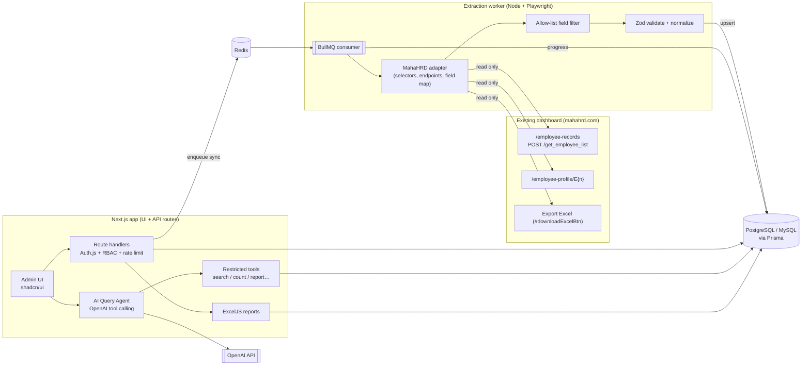

# Phase 1 — Requirement Analysis & Architecture

**Project:** AI-Powered Employee/Candidate Data Intelligence Application
**Status:** Draft for approval — no implementation code written yet
**Date:** 2026-10-31

---

## 1. What the source dashboard actually is (inspected, read-only)

Inspected with the already-authenticated Super Admin session in the browser. Only page
structure was examined; no records were changed, no buttons clicked, and **no personal
values were copied into this project**.

| Item | Finding |
|---|---|
| Product | MahaHRD (`https://mahahrd.com`) — Laravel-style server-rendered app, Bootstrap 4, jQuery, DataTables |
| Listing page | `/employee-records` → table `#employeeTable` |
| Listing data source | **Server-side DataTables**, `POST /get_employee_list` (session cookie auth) |
| Volume | **~5,125 records** (513 pages × 10 by default) |
| Stable identifier | **Yes** — employee code `E{n}`, profile URL `/employee-profile/E{n}` |
| Official export | **Yes** — button `#downloadExcelBtn` "Export Complete Resource Data" (preferred path per spec §3.B) |
| Listing columns | Sr. No., Photo, Name, Department/Project, Sub-Project/Designation, Approved CTC, Location, View |
| DataTables column keys | `emp_photo`, `fullname`, `dept_head_name`, `sub_project_name`, `approved_ctc`, `district_name` |
| Filters (request params) | `search_text`, `district` (36), `dept_head` (52), `department`, `subproject`, `designation` (cascading — populated after `dept_head`), `gender`, `education_type` (9), `type_of_employee` (Payroll / Contractual-RHE), `from_age`, `to_age` |
| Filters in your screenshot but **not found** on this page | "Form Status", "Document Verification Status" as list filters (doc status appears on the profile; "Resource Office Verification" is a separate page `/employee-office-verification`) |
| Profile sections (anchors) | `#profile_info`, `#document_info`, `#education_info`, `#employment_info`, `#epfo_info`, `#domicile_info`, `#bank_info`, `#nominee_info`, plus attendance calendar, tickets |
| Write actions present on profile | Edit Master Data (→ `resourcedata.in`), Edit Payment Structure, document approve/reject form, payment file upload, email/Form-16 — **the extractor must never touch these** |
| Auth | Session login; header shows a session-expiry countdown (~10 h). MFA/OTP not observed on this session — must be confirmed on a fresh login |

### ⚠ Sensitive data exposure (most important finding)

The profile page renders **Aadhaar number, PAN, bank account + IFSC, caste/sub-caste,
religion, blood group, nominee details, salary, emergency contacts and full address**.
Under India's DPDP Act 2023 this is personal data (and partly sensitive). The spec says
"store only approved fields" — so the default design below **excludes all of these**
and uses an allow-list per field. Nothing outside the allow-list is ever written to DB,
logs, AI prompts or exports.

---

## 2. Missing information & technical risks

### Decisions needed from you
1. **Database engine.** Spec says PostgreSQL, but the credentials you gave (`root` / `ai_automation`) are for the **MySQL 8.0.42** server running locally (I verified the DB exists and is empty). Options: (a) use MySQL locally and in prod, (b) PostgreSQL via Docker locally + prod as specified. Prisma supports both; schema below is written portable.
2. **Approved field list** (see §6). Needs sign-off from the data owner, not just the developer.
3. **Written authorization** from the MahaHRD owner (Resource Data / project owner) for automated read access and copying of records — spec §8 requires it.
4. **Dedicated service account** (read-only role if MahaHRD supports roles) rather than the Super Admin account, so automation cannot accidentally perform admin writes and actions are attributable.
5. **Export vs. scrape.** Is the "Export Complete Resource Data" Excel approved for automated use? If yes, it replaces ~513 listing requests + most profile visits with one download.

### Technical risks
| Risk | Impact | Mitigation |
|---|---|---|
| Super Admin session used by a bot | Accidental write actions | Extractor uses an allow-list of URL patterns; blocks all non-GET navigation except the listing XHR; no click handlers on action buttons; ideally read-only account |
| Excel export contains every field (incl. Aadhaar/bank) | Over-collection | Parse in memory, drop non-approved columns before persistence; never store the raw file; delete temp file immediately |
| 5,125 profile visits | Load on source, ~3–4 h at 1 req / 2–3 s | Listing/export covers most fields; profiles only for approved fields not in listing, incremental (only new/changed) |
| Cascading filters | Filter options depend on `dept_head` | Discover filter tree once per sync, cache in DB |
| Session expiry / MFA | Job failure mid-run | Persist `storageState`; checkpoint by page index; on MFA, pause job → admin completes OTP in a headed session |
| HTML/endpoint changes | Silent bad data | Zod validation on every record; schema-drift check (expected headers/column keys) at job start, fail fast |
| Dedup | — | Low risk: stable `E{n}` code. Fallback (name + DOB + mobile hash) documented but not needed |
| AI leaking PII | Data sent to OpenAI | AI gets tool results with a **reduced projection** (no mobile/email by default); row-level RBAC applied before tool results; aggregate answers preferred |

---

## 3. System architecture



**Separation of concerns**
- **Web app** never launches a browser. It only enqueues jobs and reads status.
- **Worker** is the only process holding decrypted source credentials; it runs in its own container.
- **AI agent** can only call typed tools → Prisma queries with validated params. No SQL generation, no credentials, no raw tables.
- **Adapters** isolate everything dashboard-specific (URLs, selectors, column keys, field map) so another dashboard = another adapter.

---

## 4. Proposed folder structure

Single repo, npm workspaces, two deployable apps + shared packages.

```
data-intelligence/
├─ apps/
│  ├─ web/                          # Next.js (App Router)
│  │  ├─ src/app/
│  │  │  ├─ (auth)/login/  forgot-password/
│  │  │  ├─ (dashboard)/
│  │  │  │  ├─ page.tsx                     # Main dashboard
│  │  │  │  ├─ candidates/  [id]/           # Records + detail
│  │  │  │  ├─ assistant/                   # AI chat
│  │  │  │  ├─ sync/  [jobId]/              # Sync control + history
│  │  │  │  ├─ reports/
│  │  │  │  └─ settings/ (connection, ai, users, roles, retention)
│  │  │  └─ api/
│  │  │     ├─ auth/[...nextauth]/
│  │  │     ├─ candidates/  reports/  exports/
│  │  │     ├─ sync/ (start, status, retry)
│  │  │     └─ assistant/ (chat stream)
│  │  ├─ src/components/ (ui/ = shadcn, data-table/, charts/, layout/)
│  │  ├─ src/server/
│  │  │  ├─ auth/ (auth.ts, rbac.ts)
│  │  │  ├─ services/ (candidate.service.ts, report.service.ts, sync.service.ts)
│  │  │  ├─ ai/ (agent.ts, tools/*.ts, system-prompt.ts, redact.ts)
│  │  │  ├─ excel/ (workbook builders)
│  │  │  └─ security/ (rate-limit.ts, audit.ts)
│  │  └─ tests/
│  └─ worker/                       # Playwright + BullMQ consumer
│     ├─ src/
│     │  ├─ queue/ (sync.processor.ts, scheduler.ts)
│     │  ├─ browser/ (session.ts, guard.ts  ← blocks write actions)
│     │  ├─ adapters/
│     │  │  ├─ adapter.types.ts
│     │  │  └─ mahahrd/ (config.ts, login.ts, listing.ts, profile.ts, export.ts, field-map.ts)
│     │  ├─ pipeline/ (allowlist.ts, normalize.ts, dedupe.ts, upsert.ts, checkpoint.ts)
│     │  └─ index.ts
│     └─ tests/ (fixtures/ = synthetic HTML/JSON only)
├─ packages/
│  ├─ db/          # prisma/schema.prisma, migrations, seed, client
│  ├─ schemas/     # Zod schemas shared by web + worker
│  ├─ crypto/      # AES-256-GCM credential encryption
│  └─ types/
├─ docker/ (web.Dockerfile, worker.Dockerfile, nginx/)
├─ docker-compose.yml  docker-compose.prod.yml
├─ .env.example
└─ README.md
```

---

## 5. Initial Prisma schema (draft)

Portable between PostgreSQL and MySQL (no provider-specific types). Full draft in
[`prisma-schema.draft.prisma`](prisma-schema.draft.prisma).

Key design points:
- `Candidate` holds **only allow-listed, queryable fields** (name, district, dept head/project, sub-project, designation, type, gender, education type, status fields).
- Lookup tables (`District`, `DepartmentHead`, `SubProject`, `Designation`) keep filters/reports fast and consistent; values come from the source's own filter options.
- `@@unique([sourceConnectionId, sourceEmployeeCode])` = dedup key (`E{n}`).
- `contentHash` on each candidate → incremental sync only updates changed rows.
- `SyncJob` → `SyncRecord` (per-record outcome) → `SyncError` (with retry count); `checkpoint` JSON lets a job resume from the last page.
- `SourceConnection.encryptedSecret` = AES-256-GCM ciphertext; key lives only in worker env.
- `FieldPolicy` table = the allow-list, editable in Settings, enforced in the worker pipeline.
- `AuditLog` for logins, searches, exports, AI queries, setting changes.

---

## 6. Proposed approved-field allow-list (needs your + owner sign-off)

| Field | Source | Default |
|---|---|---|
| Employee code (`E{n}`) | listing link | ✅ store |
| Full name | listing `fullname` | ✅ store |
| Department head / Project | listing `dept_head_name` | ✅ store |
| Sub-project / Designation | listing `sub_project_name` | ✅ store |
| District, Taluka | listing / profile | ✅ store |
| Employee type, Gender, Education type | filters | ✅ store |
| Date of joining / leaving, Present status | profile | ✅ store |
| Document verification status (aggregate) | profile | ✅ store |
| Office verification status | `/employee-office-verification` | ✅ store (phase 4) |
| Mobile no. | profile | ⚠ ask — store, mask in UI/AI by default |
| Official email | profile | ⚠ ask |
| Approved CTC | listing | ⚠ ask — salary data |
| Photo | listing | ❌ don't store (link only, if at all) |
| Aadhaar, PAN, bank, IFSC, UPI | profile | ❌ never |
| Caste, sub-caste, religion, blood group, marital status | profile | ❌ never |
| Nominee, emergency contact, family, address | profile | ❌ never |
| Attendance, tickets, payment files, Form-16 | profile | ❌ out of scope |

---

## 7. Data Extraction Agent workflow

1. Admin clicks **Start Sync** → API checks role, creates `SyncJob(QUEUED)`, enqueues to BullMQ (job lock: one active sync per connection).
2. Worker loads connection, decrypts credentials in memory, launches Chromium with saved `storageState` if still valid.
3. **Login**: fill username/password on the real login form (selectors confirmed during Phase 3). If OTP/CAPTCHA appears → job state `AWAITING_MFA`, worker opens a headed/VNC session or asks admin to paste a fresh session; **never** solves or bypasses it.
4. **Guard**: Playwright `route()` blocks any request that isn't GET page navigation or the allow-listed `POST /get_employee_list`; action buttons are never clicked.
5. **Drift check**: verify `#employeeTable` headers and DataTables column keys match the adapter config; abort if not.
6. **Collect**:
   - *Preferred (if approved):* trigger the official export, parse with ExcelJS in memory, keep only allow-listed columns, delete the file.
   - *Fallback:* call the listing endpoint from within the page context with the session cookie, `length=100`, 1 request every ~2 s, checkpoint after each page.
7. **Enrich** (only for allow-listed fields not in listing): visit `/employee-profile/E{n}` for new or stale records, read only the mapped sections, ~1 profile per 2–3 s.
8. **Pipeline per record**: allow-list filter → Zod validate → normalize (title-case names, trim, ISO dates, uppercase districts, E.164 mobile) → hash → upsert by `(connection, code)` → `SyncRecord` (CREATED / UPDATED / UNCHANGED / FAILED).
9. Failures go to `SyncError` with retry count; **Retry failed** re-runs only those codes.
10. Job finishes `SUCCEEDED` / `PARTIAL` / `FAILED` with counts; UI polls `/api/sync/:id`.

Phase 3 scope is deliberately **one record** end-to-end before any bulk run.

---

## 8. AI Query Agent workflow

1. Admin types a question in **AI Assistant**.
2. Server builds an OpenAI request with a system prompt + **only tool schemas** (no data, no credentials) plus current filter vocab (district/project/designation names) so it can map "Kolhapur" → `KOLHAPUR`.
3. Model returns a tool call, e.g. `search_candidates({ district: "KOLHAPUR" })`.
4. Server validates args with Zod, applies RBAC scope (e.g. a district-scoped user can only see their districts), runs a parameterized Prisma query, caps rows (e.g. 50 to the model, full set kept server-side under a `resultId`).
5. Tool result sent back to the model is **redacted** (no mobile/email unless the role allows) — for counts/aggregates only numbers are sent.
6. Model writes the summary; UI renders the summary card + the full table from `resultId` + **Export Excel** button (`/api/exports?resultId=…`).
7. Unsupported or unsafe requests (write/delete, raw SQL, sensitive fields) → refused with an explanation. Every query is written to `AuditLog`.

Tools: `search_candidates`, `get_candidate_details`, `filter_candidates`, `count_candidates` (with `groupBy`), `generate_candidate_report`, `get_sync_status`.

---

## 9. Phase roadmap

| Phase | Deliverable | Exit check |
|---|---|---|
| 1 Analysis | This document + schema draft | **Your approval** |
| 2 Foundation | Monorepo, Next.js + Tailwind + shadcn, Prisma migrate, Auth.js (credentials + RBAC), app shell, empty pages, seed admin | `npm test`, login works, migration applied |
| 3 Extraction prototype | Worker, MahaHRD adapter, guard, **one** record end-to-end | Record in DB, re-run = UNCHANGED (dedup proven), your review |
| 4 Full extraction | Export/listing path, pagination, filters, profile enrichment, checkpoints, retries, Sync UI | Synthetic-fixture tests; small real run (e.g. one district) before full |
| 5 AI | Agent + 6 tools + chat UI | Tool tests with synthetic data, refusal tests |
| 6 Reports | District/dept/project/designation reports, ExcelJS export, report history | Export tests |
| 7 Test & deploy | Security review, Docker, Nginx, HTTPS, backups, Hostinger guide | Health checks green on VPS |
| 8 Scheduling | BullMQ repeatable jobs, incremental sync, failure notifications | Scheduled run observed |

---

## 10. What I need from you to configure the source dashboard

1. **Written authorization** from the MahaHRD/Resource Data owner for automated read access and storing copies.
2. **Approved field list** — confirm/edit §6 (especially mobile, email, CTC).
3. **Service account**: a dedicated, ideally read-only login (username only in chat is fine; the password goes into `.env` / Settings, never chat).
4. **Login flow details**: login URL, whether OTP/MFA/CAPTCHA appears, who receives the OTP.
5. **Export approval**: may the worker use "Export Complete Resource Data"?
6. **Rate / time window**: acceptable request rate and preferred sync hours (e.g. nights).
7. **Scope**: all ~5,125 records or only specific projects/districts (e.g. PMAY / Rural Housing)?
8. **DB decision**: MySQL (your local `ai_automation`) or PostgreSQL as the spec states.
9. **OpenAI**: API key (into `.env` only) and preferred model; confirm sending reduced, non-sensitive record data to OpenAI is acceptable.
10. **App users**: roles you need (e.g. Super Admin, Admin, District Viewer) and whether any user should be restricted by district/project.
